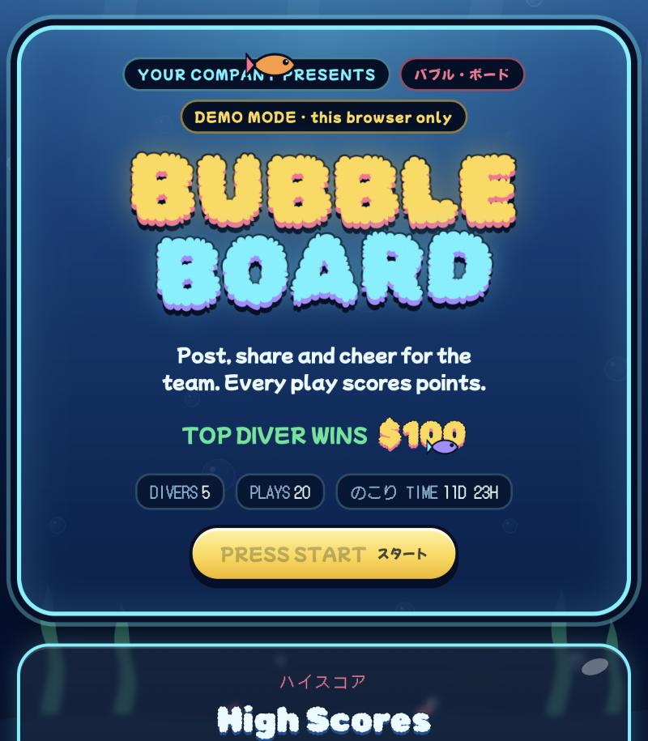

# Bubble Board 🫧

An underwater, Japanese-arcade high score board for employee advocacy.

Your team logs every LinkedIn and Instagram play (posts, reshares, comments, likes, stories). Each play scores points, the board ranks everyone, and the top diver wins the prize.



**Try the demo:** https://alyssanewman.github.io/bubble-board/

Built with Claude by Alyssa Newman, [PVLP Social](https://pvlpsocial.com).

---

## What's inside

- Bubble-letter marquee, rising bubbles, swaying kelp and a fish or two
- High scores with 1位 / 2位 / 3位 pearl badges
- Log a play: pick LinkedIn or Instagram, pick the move, paste the link
- A rules panel that builds itself from your point values
- A live feed of the latest plays
- A Game Master panel for contest dates and removing fake plays
- A daily like cap (10 by default) so nobody farms likes
- The same post can't score twice for the same move

## Two ways to run it

| | Demo mode | Team mode |
|---|---|---|
| Where | GitHub Pages, or open `index.html` on your computer | Published as a Claude artifact |
| Who sees the scores | Only the person on that browser | Everyone you share it with |
| Good for | Showing people, testing your setup | Running a real contest |

The page detects where it's running. On GitHub it opens in demo mode with five sample divers. Inside Claude it switches to one shared, live board for the whole team.

## Make your own with Claude (about 5 minutes)

1. Download `index.html` from this repo (click the file, then the download button).
2. Open [claude.ai](https://claude.ai) and start a new chat.
3. Attach `index.html` and paste the prompt from [MAKE-YOUR-OWN.md](MAKE-YOUR-OWN.md).
4. Answer Claude's questions (company name, prize, dates).
5. Claude publishes your board. Share the link with your team.

Teammates need a claude.ai account to play on the shared board.

## Customize it by hand

Everything lives in the `CONFIG` block at the top of the script in `index.html`:

```js
const CONFIG = {
  company: "Your Company",
  instagram: "@yourcompany",
  titleLines: ["BUBBLE", "BOARD"],
  prize: "$100",
  likeCap: 10,
  moves: [ /* point values for every play */ ],
};
```

Change the words, the prize, the point values or the plays. The rules panel updates to match.

## Put your own copy on GitHub Pages

1. Click **Use this template** at the top of this repo, then **Create a new repository**.
2. In your new repo, open **Settings → Pages**.
3. Under **Branch**, pick `main` and `/ (root)`, then **Save**.
4. Wait a minute. Your board is live at `https://<your-username>.github.io/<repo-name>/`.

## License

MIT. Use it, remix it, run a contest with it. A shout-out is always appreciated.
